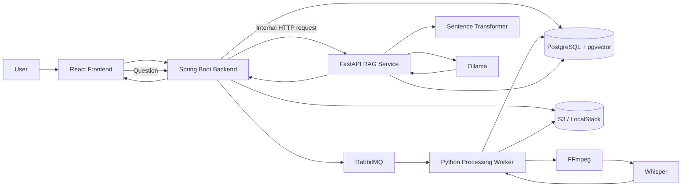
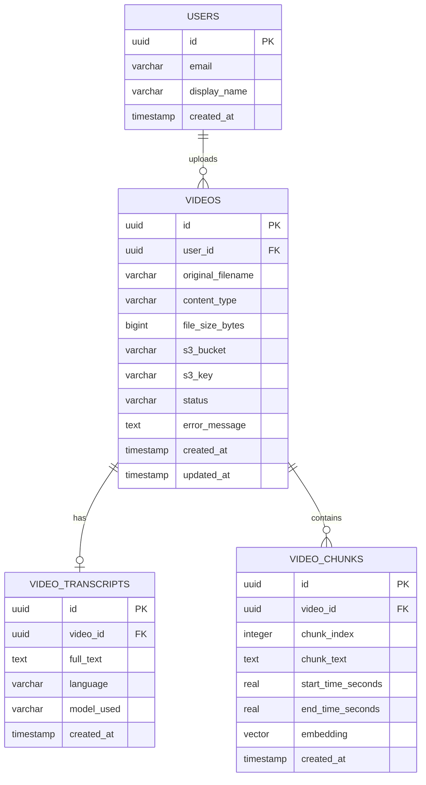

# ShrutaBodha — From-Scratch Build Blueprint

> **Purpose of this document:** A portable project specification and implementation guide for rebuilding ShrutaBodha from an empty repository. It is written so that another developer or a fresh ChatGPT conversation can understand the product, architecture, technology choices, workflows, APIs, data model, and build order without relying on earlier chat history.
>
> **Important baseline:** Treat this as a new build. Do not assume that old code, containers, database tables, configuration, or previous implementations still exist. Implement and verify every phase in this document.

---

## 1. Project overview

### 1.1 What is ShrutaBodha?

ShrutaBodha is an AI-powered application that turns videos and audio into searchable knowledge. A user uploads a video, the system extracts its audio, transcribes the speech, stores the transcript, converts transcript segments into vector embeddings, and makes those segments searchable through a Retrieval-Augmented Generation (RAG) chatbot.

Instead of watching an entire video again to find one explanation, a user can ask a natural-language question such as:

- “What did the speaker say about dependency injection?”
- “Summarize the main points from this video.”
- “What are the disadvantages mentioned?”
- “At what point does the speaker explain the second concept?”

The system retrieves transcript passages relevant to the question and gives them to a language model as context. The model generates an answer grounded in those passages.

### 1.2 One-line description

**ShrutaBodha is an AI-powered video transcription and knowledge-retrieval platform that converts videos into searchable transcripts and enables context-aware question answering using RAG.**

### 1.3 Problem being solved

Video platforms are excellent for consuming content, but they are not always convenient when a person wants to retrieve one specific fact or explanation. Rewatching, manually scrubbing, and searching long transcripts can be time-consuming.

ShrutaBodha aims to make video content:

- **Searchable:** retrieve relevant parts using natural-language questions.
- **Understandable:** ask questions and receive concise explanations.
- **Reusable:** preserve transcripts and extracted knowledge for later access.
- **Navigable:** eventually connect answers to timestamps in the original video.

### 1.4 Primary user journey

1. The user opens ShrutaBodha.
2. The user uploads a supported video file.
3. The application stores the original file and creates a video record.
4. The system queues a background processing job.
5. A Python worker extracts audio and transcribes it.
6. The transcript is saved and divided into smaller chunks.
7. The application generates an embedding for every chunk and stores the vectors.
8. The video processing status changes to `COMPLETED`.
9. The user opens the processed video and asks a question.
10. ShrutaBodha retrieves relevant transcript chunks and generates an answer from that context.

---

## 2. Scope and product boundaries

### 2.1 MVP / Version 1 — build this first

The first release should prove the entire video-to-answer pipeline end to end.

| Area | MVP capability |
|---|---|
| Video upload | Upload one supported video file through the application API |
| Object storage | Store the original video in S3-compatible storage |
| Job processing | Publish a processing message to RabbitMQ |
| Audio extraction | Extract audio from the video using FFmpeg |
| Transcription | Generate a transcript using Whisper |
| Transcript persistence | Save the full transcript and basic metadata in PostgreSQL |
| Chunking | Divide the transcript into overlapping, searchable segments |
| Embeddings | Generate vector embeddings using Sentence Transformers |
| Vector storage | Store the embeddings using PostgreSQL with pgvector |
| RAG | Retrieve relevant chunks and generate a grounded answer using a local LLM served by Ollama |
| API | Expose upload, processing-status, transcript, and chat endpoints |
| Frontend | Provide a minimal interface to upload a video, see its status, view its transcript, and chat with it |

**Definition of MVP success:** A user can upload a video, wait for processing to finish, ask a question about it, and receive an answer supported by the video's transcript.

### 2.2 Explicitly out of scope for the first release

Do not delay the MVP by starting with these features:

- Live or real-time transcription.
- Multi-video search or cross-video question answering.
- Persistent conversational memory across sessions.
- Advanced agent workflows or LangGraph orchestration.
- Speaker diarization.
- Automatic translation into multiple languages.
- Complex semantic chunking or reranking.
- Production-grade multi-tenant authentication and billing.
- Kubernetes or a distributed microservice platform.

These can be evaluated after the basic pipeline is reliable.

### 2.3 Future roadmap

**Version 2 — improve retrieval and usability**
- Store and display timestamps for transcript chunks.
- Link chatbot answers to the relevant video timestamps.
- Improve chunking and retrieval quality.
- Add keyword + vector hybrid search.
- Add reranking if basic retrieval is not sufficient.
- Stream generated answers to the frontend.
- Add better retry handling, observability, and processing metrics.

**Version 3 — richer knowledge experience**
- Video summaries, chapter summaries, topics, and keywords.
- Chat sessions and conversation history.
- Multiple-video collections and cross-video search.
- Meeting notes, action items, and key takeaways.
- LangGraph only if the workflow grows into genuinely multi-step or stateful agent orchestration.

**Version 4 — production readiness**
- Authentication and authorization.
- Cloud object storage and cloud deployment.
- Worker scaling and workload limits.
- CI/CD, structured monitoring, alerting, and tracing.
- Rate limiting, caching, retention policies, and database optimization.

---

## 3. Recommended technology stack

The stack intentionally separates the main application API from the Python-based media and AI processing.

### 3.1 Technology summary

| Layer | Technology | Responsibility |
|---|---|---|
| Main backend | Java 21, Spring Boot, Maven | REST APIs, upload orchestration, metadata, validation, and communication with internal services |
| Backend web | Spring Web | HTTP endpoints and request/response handling |
| Backend persistence | Spring Data JPA, Hibernate | Persistence of application entities such as videos and users |
| Backend messaging | Spring AMQP | Publishing video-processing jobs to RabbitMQ |
| Object storage integration | AWS SDK for Java v2, S3 client | Upload and access video objects in S3-compatible storage |
| Database | PostgreSQL | Store users, video metadata, transcripts, and chunks |
| Vector database capability | pgvector extension | Store embeddings and perform similarity search within PostgreSQL |
| Message broker | RabbitMQ | Decouple uploads from expensive processing |
| S3-compatible local storage | LocalStack S3 | Local development object storage; can later be replaced by AWS S3 or another compatible service |
| AI / worker runtime | Python | Background media processing, transcription, embeddings, and RAG support |
| Media processing | FFmpeg | Extract and convert audio from uploaded video files |
| Speech-to-text | OpenAI Whisper | Convert extracted audio into text and segment metadata |
| Embeddings | Sentence Transformers, `all-MiniLM-L6-v2` | Convert transcript chunks and questions into 384-dimensional vectors |
| RAG API | FastAPI | Internal Python HTTP API for question answering |
| Vector access | pgvector Python support or SQL with psycopg | Persist vectors and execute similarity queries |
| Local LLM runtime | Ollama | Serve a locally hosted language model for response generation |
| Frontend | React + TypeScript + Vite (recommended) | Upload UI, processing status, transcript display, and chat interface |
| UI styling | Tailwind CSS (optional) | Styling the frontend without building a design system from scratch |
| Containers | Docker, Docker Compose | Run application services and local infrastructure consistently |
| Testing | JUnit 5, Mockito, Spring Boot Test; pytest | Unit and integration tests for Java and Python components |
| API exploration | Swagger UI / Springdoc and FastAPI `/docs` | Inspect and test API contracts during development |
| Source control | Git and GitHub | Track implementation history and release checkpoints |

### 3.2 Why this stack?

**Spring Boot for the main backend**

The main application is a good place to apply Java, Spring Boot, REST API design, dependency injection, service/repository separation, validation, transactions, and messaging. It provides a clear backend engineering foundation and coordinates the product's main business flow.

**Python for media and AI processing**

The transcription, audio-processing, and embedding ecosystem is strongest and easiest to integrate from Python. Keeping these workloads in Python avoids forcing AI/media libraries into the Java application.

**RabbitMQ for asynchronous processing**

Transcription and embedding generation can take much longer than a normal HTTP request. The upload request should finish after the video is safely stored and the job is queued; a worker can process it independently. This keeps the upload API responsive and allows background processing to be retried.

**PostgreSQL + pgvector**

The application needs relational data such as video records and transcript metadata, as well as vector similarity search. PostgreSQL with pgvector supports both without introducing a separate vector database for the MVP.

**LocalStack for local S3 development**

The application can develop against an S3-compatible API locally. The same storage abstraction can later be configured for a real S3 bucket.

**Ollama for local model serving**

Ollama provides a local HTTP interface for model inference. Model choice should be configurable. Select a model that actually fits the machine's available RAM/VRAM; do not assume a model will run merely because Ollama itself starts successfully.

### 3.3 Dependency and version policy

- Use Java 21 for the backend baseline.
- Select a currently supported Spring Boot release compatible with Java 21 when creating the project. Avoid copying an old version number from a previous implementation.
- Use a supported Python version compatible with the selected Whisper, PyTorch, and Sentence Transformers releases.
- Pin dependencies after a successful clean build and record them in `pom.xml` and Python dependency files.
- Keep model names, model URLs, bucket names, queue names, and credentials in configuration rather than scattering them through source code.
- Do not commit `.env`, passwords, access keys, or local model files to Git.

---

## 4. High-level architecture

### 4.1 Logical architecture



### 4.2 Services and ownership

The recommended deployment has separate runtime processes, even if the worker and RAG API share one Python codebase.

| Service | Owns / does | Does not do |
|---|---|---|
| Frontend | User interaction and display | Run transcription or talk directly to PostgreSQL |
| Spring Boot backend | Public API, validation, video metadata, S3 upload, job publication, chat orchestration | Run Whisper or generate embeddings synchronously during upload |
| Python processing worker | Consume jobs, download media, extract audio, transcribe, chunk, embed, persist processing output | Serve public user-facing APIs |
| FastAPI RAG service | Accept internal chat requests, retrieve relevant chunks, build prompts, call the LLM | Handle video uploads or consume processing jobs |
| PostgreSQL + pgvector | Durable application and retrieval data | Store original video binaries |
| RabbitMQ | Durable job delivery and retry routing | Store video files or transcripts |
| S3 / LocalStack | Original video object storage | Store application relational records |
| Ollama | Run the selected language model | Decide which transcript passages are relevant; that is the retrieval layer's job |

The worker and RAG service may import shared Python modules for configuration, database access, and embedding generation. Run them as separate processes/containers so that a long transcription job does not block chatbot requests.

### 4.3 Main architectural principles

1. **Keep HTTP requests short.** Uploading a file may take time, but transcription must happen asynchronously after the API has queued the job.
2. **Separate responsibilities.** Spring Boot owns application APIs and orchestration; Python owns media and AI-heavy work.
3. **Use one source of truth.** PostgreSQL stores application records, transcript text, and vectors. S3 stores the original media.
4. **Make processing repeatable.** A worker must be able to safely retry a job without creating duplicate transcript/chunk records.
5. **Keep internal services private.** The frontend should call Spring Boot, not RabbitMQ, PostgreSQL, Ollama, or the internal RAG service directly.
6. **Make models configurable.** The embedding model and LLM should be chosen through configuration, not hardcoded across multiple modules.
7. **Start with manual RAG.** Retrieval, prompt construction, and LLM invocation can be implemented explicitly. Add an orchestration framework only when the application needs it.

---

## 5. Detailed functional workflows

## 5.1 Workflow A — upload and queue a video

1. The user selects a video in the frontend.
2. The frontend sends a multipart request to Spring Boot.
3. The controller delegates to `VideoService`.
4. The service validates file presence, file type, and configured size limits.
5. The service generates a UUID for the video.
6. The service uploads the original file to S3 using a predictable object key, for example:
   `videos/{videoId}/original/{safeFileName}`.
7. The service saves a `videos` row with the S3 bucket/key and an initial processing status.
8. After the metadata is committed, the backend publishes a `VideoProcessingRequested` message to RabbitMQ.
9. The API returns the video ID and current status. It does not wait for Whisper to finish.
10. The frontend uses the video ID to poll the status endpoint or later subscribes to a push mechanism.

**Important reliability note:** There is a possible failure window between saving the video row and publishing the RabbitMQ message. For an MVP, handle publishing errors explicitly and mark the video as failed-to-queue or retryable. A transactional outbox is a stronger production solution and can be added later.

### Suggested RabbitMQ message

```json
{
  "eventId": "a-unique-message-id",
  "videoId": "video-uuid",
  "bucket": "shrutabodha-videos",
  "objectKey": "videos/video-uuid/original/video.mp4",
  "requestedAt": "2026-11-21T10:00:00Z"
}
```

The message should contain identifiers and storage coordinates, not the entire video file or transcript.

## 5.2 Workflow B — process the video in Python

1. The worker listens to a durable RabbitMQ queue.
2. It receives a `VideoProcessingRequested` message.
3. It validates the message and checks whether the video is already completed or currently being processed.
4. It updates the video status to `PROCESSING`.
5. It downloads the S3 object to a temporary working directory.
6. It invokes FFmpeg to extract audio and convert it into a format suitable for Whisper.
7. It runs Whisper transcription.
8. It extracts the transcript text, language, and segment timestamps when available.
9. It persists the full transcript.
10. It divides the transcript into overlapping chunks, preferably respecting sentence/segment boundaries and the embedding model's input limit.
11. It generates one embedding for each chunk using the configured Sentence Transformer model.
12. It stores each chunk, its order, timestamps, and embedding in PostgreSQL.
13. It marks the video `COMPLETED` only after all required records are saved successfully.
14. It removes temporary downloaded media/audio files according to the cleanup policy.
15. It acknowledges the RabbitMQ message only when processing has reached a successful terminal state.

### Status lifecycle

Use explicit status values so that the frontend and backend can explain what is happening.

```text
UPLOADED
   |
   v
QUEUED
   |
   v
PROCESSING
   |
   +--> TRANSCRIBING
   |
   +--> CHUNKING
   |
   +--> EMBEDDING
   |
   v
COMPLETED

Any processing stage can transition to FAILED when a non-recoverable error occurs.
```

Recommended enum values:

- `UPLOADED`
- `QUEUED`
- `PROCESSING`
- `TRANSCRIBING`
- `CHUNKING`
- `EMBEDDING`
- `COMPLETED`
- `FAILED`

The status model can be simplified if implementation becomes unnecessarily complicated, but it should at least distinguish queued, processing, completed, and failed.

### FFmpeg example

A starting point for converting a video to mono 16 kHz PCM WAV is:

```bash
ffmpeg -i input.mp4 -vn -acodec pcm_s16le -ar 16000 -ac 1 output.wav
```

The worker must execute FFmpeg as a subprocess, capture its exit code and error output, and handle missing executables or invalid media files. Do not assume that activating a Python virtual environment installs the FFmpeg executable; FFmpeg is a system dependency or a container image dependency.

### Retry and idempotency rules

- Use a stable `videoId` as the processing identity.
- Add uniqueness constraints such as one transcript per video and one chunk index per video.
- Before reprocessing, either clean up the previous generated transcript/chunks in a transaction or use a well-defined upsert strategy.
- A duplicate message must not create duplicate transcript or chunk records.
- Use a retry limit and a dead-letter queue (DLQ) for messages that repeatedly fail.
- Record a concise failure reason in the video row and detailed diagnostics in logs.
- Do not acknowledge a message before the successful database writes are committed.

## 5.3 Workflow C — ask a question using RAG

1. The user opens a completed video and enters a question.
2. The frontend sends the question and `videoId` to Spring Boot.
3. `ChatController` validates the request and calls `RAGService`.
4. `RAGService` makes an internal HTTP request to the FastAPI RAG service.
5. FastAPI validates the request and calls the RAG logic.
6. The RAG service creates an embedding for the user's question using the **same embedding model** used during ingestion.
7. It performs vector similarity search in `video_chunks`, filtered to the requested video.
8. It selects the most relevant chunks and their timestamps.
9. The prompt builder creates a prompt containing the retrieved context and user question.
10. The LLM client sends the prompt to Ollama.
11. Ollama generates an answer.
12. FastAPI returns the answer and, preferably, the supporting chunk references to Spring Boot.
13. Spring Boot returns a stable response DTO to the frontend.
14. The frontend displays the answer and, when available, links to the supporting transcript/video timestamps.

### RAG concepts in this project

**Embedding:** A numerical vector representing the semantic meaning of text. Similar meanings should be close in the embedding space according to the chosen similarity metric.

**Chunking:** Dividing the transcript into smaller pieces so retrieval can select only the portions relevant to a question. Chunk boundaries should avoid splitting a sentence or thought unnecessarily.

**Vector search:** Comparing the question embedding with stored chunk embeddings and selecting the closest matches.

**Retrieval-Augmented Generation:** Passing retrieved transcript passages to an LLM along with the user's question so the answer is based on source material rather than only the LLM's pretraining.

### RAG safeguards

- Filter every retrieval query by `video_id`; do not accidentally search every user's videos.
- Use the exact same embedding model and vector dimension during indexing and querying.
- Make `topK` configurable; begin with a small value such as 5 and evaluate results.
- Consider a configurable relevance threshold so unrelated chunks are not blindly supplied to the model.
- Instruct the LLM to answer from the supplied transcript context and explicitly say when the transcript does not contain the answer.
- Treat transcript text as untrusted source material. Do not let instructions embedded inside a transcript override the system's answer policy.
- Return source chunk IDs and timestamps so answers can be inspected and grounded.
- Handle empty retrieval results without calling the LLM unnecessarily.
- Set HTTP timeouts and handle Ollama/network/model errors explicitly.

---

## 6. Data model and database design

Use PostgreSQL as the primary database and enable the pgvector extension.

### 6.1 Core entities



For an unauthenticated local MVP, the `users` table can be deferred. Keep the `user_id` relationship optional only if that matches the chosen implementation. Do not build a full account system before the upload-to-chat pipeline works.

### 6.2 Example schema

The exact SQL should be managed through database migrations (recommended: Flyway for the Java application or a clearly owned migration process). Avoid making schema changes manually without recording them in the repository.

```sql
CREATE EXTENSION IF NOT EXISTS vector;

CREATE TABLE videos (
    id UUID PRIMARY KEY,
    original_filename VARCHAR(512) NOT NULL,
    content_type VARCHAR(150) NOT NULL,
    file_size_bytes BIGINT NOT NULL,
    s3_bucket VARCHAR(255) NOT NULL,
    s3_key TEXT NOT NULL,
    status VARCHAR(30) NOT NULL,
    error_message TEXT,
    created_at TIMESTAMP NOT NULL DEFAULT CURRENT_TIMESTAMP,
    updated_at TIMESTAMP NOT NULL DEFAULT CURRENT_TIMESTAMP
);

CREATE TABLE video_transcripts (
    id UUID PRIMARY KEY,
    video_id UUID NOT NULL UNIQUE REFERENCES videos(id) ON DELETE CASCADE,
    full_text TEXT NOT NULL,
    language VARCHAR(50),
    model_used VARCHAR(100),
    created_at TIMESTAMP NOT NULL DEFAULT CURRENT_TIMESTAMP
);

CREATE TABLE video_chunks (
    id UUID PRIMARY KEY,
    video_id UUID NOT NULL REFERENCES videos(id) ON DELETE CASCADE,
    chunk_index INTEGER NOT NULL,
    chunk_text TEXT NOT NULL,
    start_time_seconds REAL,
    end_time_seconds REAL,
    embedding VECTOR(384) NOT NULL,
    created_at TIMESTAMP NOT NULL DEFAULT CURRENT_TIMESTAMP,
    CONSTRAINT uq_video_chunk_index UNIQUE (video_id, chunk_index)
);
```

If users are included in the initial schema, add a `users` table and a foreign key from `videos.user_id`. If authentication is not being built yet, do not add unused auth tables merely for appearance.

### 6.3 Vector dimension and similarity metric

`all-MiniLM-L6-v2` produces 384-dimensional sentence embeddings. Therefore `VECTOR(384)` is suitable only while that model (or another 384-dimensional model) is used.

For cosine similarity, use pgvector's cosine distance operator (`<=>`) consistently for retrieval and a matching index operator class if/when an index is added. The embedding model, preprocessing, and distance metric should remain consistent between chunk creation and question-time embedding generation.

Example query:

```sql
SELECT
    id,
    chunk_index,
    chunk_text,
    start_time_seconds,
    end_time_seconds,
    embedding <=> :query_embedding AS distance
FROM video_chunks
WHERE video_id = :video_id
ORDER BY embedding <=> :query_embedding
LIMIT :top_k;
```

The exact parameter binding depends on the Python database driver and pgvector adapter. Verify vector parameter adaptation with a real integration test rather than assuming a Python list will be accepted automatically.

An HNSW index may be added after basic retrieval works and the dataset justifies it. For a small local dataset, begin with a straightforward query and measure before adding index complexity.

### 6.4 Why retain chunk timestamps?

Whisper can provide segment-level timing. Preserve timing as the transcript is chunked. A chunk should ideally carry its approximate start and end times. This will allow a later frontend to show “Jump to 05:42” next to an answer rather than returning text with no way to locate the original explanation.

---

## 7. API design

The frontend should communicate with the Spring Boot backend only. The Python RAG API is an internal service.

### 7.1 Public Spring Boot API

| Method | Endpoint | Purpose |
|---|---|---|
| `POST` | `/api/videos` | Upload a video and queue processing |
| `GET` | `/api/videos` | List uploaded videos (can be deferred for the first vertical slice) |
| `GET` | `/api/videos/{videoId}` | Fetch metadata and processing status |
| `GET` | `/api/videos/{videoId}/transcript` | Fetch the generated transcript |
| `POST` | `/api/videos/{videoId}/chat` | Ask a question about one video |
| `DELETE` | `/api/videos/{videoId}` | Delete a video and related data (later, with safe object cleanup) |

### 7.2 Upload request and response

Request: `multipart/form-data`, with a field named `file`.

Example response:

```json
{
  "videoId": "2c7b2a14-3b8c-4f1f-a5af-4b8d5c4f13b0",
  "status": "QUEUED",
  "message": "Video uploaded and queued for processing."
}
```

Use HTTP `202 Accepted` because processing continues asynchronously after the upload request is accepted.

### 7.3 Processing status response

```json
{
  "videoId": "2c7b2a14-3b8c-4f1f-a5af-4b8d5c4f13b0",
  "fileName": "spring-boot-session.mp4",
  "status": "TRANSCRIBING",
  "errorMessage": null,
  "createdAt": "2026-11-21T10:00:00Z",
  "updatedAt": "2026-11-21T10:04:00Z"
}
```

Do not expose S3 credentials, internal file-system paths, or stack traces in public responses.

### 7.4 Transcript response

```json
{
  "videoId": "2c7b2a14-3b8c-4f1f-a5af-4b8d5c4f13b0",
  "language": "en",
  "transcript": "The full transcript text goes here..."
}
```

A later API version can return timestamped segments or paginated chunks rather than one large text field.

### 7.5 Chat request and response

Request:

```json
{
  "question": "What is dependency injection?"
}
```

Endpoint: `POST /api/videos/{videoId}/chat`.

Response:

```json
{
  "videoId": "2c7b2a14-3b8c-4f1f-a5af-4b8d5c4f13b0",
  "answer": "Dependency injection is ...",
  "sources": [
    {
      "chunkId": "f5a57d3a-5c9a-4a52-9bf2-22ab8c1761e0",
      "startTimeSeconds": 342.0,
      "endTimeSeconds": 389.0,
      "text": "The speaker explains that ..."
    }
  ]
}
```

Returning sources is strongly recommended, even if the first frontend only displays the answer. It makes debugging and answer grounding much easier.

### 7.6 Internal FastAPI endpoint

`POST /internal/rag/ask`

Request:

```json
{
  "video_id": "2c7b2a14-3b8c-4f1f-a5af-4b8d5c4f13b0",
  "question": "What is dependency injection?"
}
```

Response:

```json
{
  "answer": "Dependency injection is ...",
  "sources": [
    {
      "chunk_id": "f5a57d3a-5c9a-4a52-9bf2-22ab8c1761e0",
      "start_time_seconds": 342.0,
      "end_time_seconds": 389.0,
      "text": "The speaker explains that ..."
    }
  ]
}
```

The internal service should be reachable only on the private Docker network during normal deployment. It should have explicit request timeouts, health checks, and structured error responses.

### 7.7 HTTP status behavior

Use predictable status codes:

- `200 OK` — successful read/chat operation.
- `202 Accepted` — upload accepted and queued.
- `400 Bad Request` — invalid request fields.
- `404 Not Found` — unknown video ID.
- `409 Conflict` — video is not yet ready for chat, or an operation conflicts with the current state.
- `413 Payload Too Large` — upload exceeds configured size.
- `415 Unsupported Media Type` — unsupported file type.
- `500 Internal Server Error` — unexpected server failure.
- `503 Service Unavailable` — a required internal dependency is unavailable.

Return a consistent error body. Do not leak exception stack traces to clients.

---

## 8. Suggested repository structure

Use a clear monorepo structure. The following is a recommended starting point; it is not a requirement to create every package on day one.

```text
shruta-bodha/
├── backend/                         # Java / Spring Boot application
│   ├── pom.xml
│   └── src/
│       ├── main/
│       │   ├── java/com/shrutabodha/backend/
│       │   │   ├── BackendApplication.java
│       │   │   ├── config/
│       │   │   │   ├── RabbitMQConfig.java
│       │   │   │   └── S3Config.java
│       │   │   ├── controller/
│       │   │   │   ├── VideoController.java
│       │   │   │   └── ChatController.java
│       │   │   ├── dto/
│       │   │   │   ├── VideoUploadResponse.java
│       │   │   │   ├── VideoStatusResponse.java
│       │   │   │   ├── VideoProcessingMessage.java
│       │   │   │   ├── ChatRequest.java
│       │   │   │   └── ChatResponse.java
│       │   │   ├── entity/
│       │   │   │   └── Video.java
│       │   │   ├── enums/
│       │   │   │   └── VideoStatus.java
│       │   │   ├── exception/
│       │   │   │   └── GlobalExceptionHandler.java
│       │   │   ├── repository/
│       │   │   │   └── VideoRepository.java
│       │   │   └── service/
│       │   │       ├── VideoService.java
│       │   │       ├── VideoProcessingProducerService.java
│       │   │       └── RAGService.java
│       │   └── resources/
│       │       ├── application.yml
│       │       └── db/migration/
│       └── test/
│
├── ai/                              # Shared Python AI codebase
│   ├── requirements.txt
│   ├── .env.example
│   ├── app/
│   │   ├── __init__.py
│   │   ├── config.py
│   │   ├── database.py
│   │   ├── embeddings.py
│   │   ├── worker/
│   │   │   ├── __init__.py
│   │   │   ├── consumer.py
│   │   │   ├── pipeline.py
│   │   │   └── processing_status.py
│   │   ├── services/
│   │   │   ├── __init__.py
│   │   │   ├── s3_service.py
│   │   │   ├── ffmpeg_service.py
│   │   │   ├── transcription_service.py
│   │   │   ├── chunking_service.py
│   │   │   └── persistence_service.py
│   │   └── rag/
│   │       ├── __init__.py
│   │       ├── retrieval.py
│   │       ├── prompt_builder.py
│   │       ├── llm_client.py
│   │       └── rag_service.py
│   ├── run_worker.py                # Starts RabbitMQ consumer
│   └── run_rag_api.py               # Starts FastAPI app
│
├── frontend/                        # React + TypeScript + Vite
│   ├── package.json
│   └── src/
│
├── infra/
│   ├── docker-compose.yml
│   └── postgres/
│       └── init/                     # Optional local DB initialization
│
├── docs/
│   ├── architecture.md
│   └── api-contracts.md
│
├── .env.example
├── .gitignore
└── README.md
```

### Package dependency direction

Keep dependencies flowing in a predictable direction:

- `worker/` orchestrates worker services.
- `services/` contains focused operations such as S3 download, FFmpeg execution, transcription, chunking, and persistence.
- `rag/` contains retrieval, prompt building, and LLM interaction.
- `database.py`, `config.py`, and `embeddings.py` are shared infrastructure modules.
- Do not make low-level service modules import high-level workflow modules. For example, an S3 service should not import the RAG service.

The FastAPI application can import the RAG service, while the message worker can import the processing pipeline. Run them independently.

---

## 9. Configuration and environment variables

Use environment variables for environment-specific configuration. Commit `.env.example` with placeholders, but never commit the actual `.env` file.

Example configuration inventory:

```dotenv
# Application
APP_ENV=local

# PostgreSQL
POSTGRES_HOST=localhost
POSTGRES_PORT=5432
POSTGRES_DB=shrutadb
POSTGRES_USER=appuser
POSTGRES_PASSWORD=change-me

# RabbitMQ
RABBITMQ_HOST=localhost
RABBITMQ_PORT=5672
RABBITMQ_USERNAME=guest
RABBITMQ_PASSWORD=guest
RABBITMQ_VIDEO_QUEUE=video.processing

# S3 / LocalStack
S3_ENDPOINT_URL=http://localhost:4566
S3_REGION=us-east-1
S3_BUCKET=shrutabodha-videos
AWS_ACCESS_KEY_ID=test
AWS_SECRET_ACCESS_KEY=test

# Python services
RAG_API_HOST=0.0.0.0
RAG_API_PORT=8000
RAG_API_URL=http://localhost:8000

# Embedding model
EMBEDDING_MODEL=sentence-transformers/all-MiniLM-L6-v2
EMBEDDING_DIMENSION=384

# Ollama
OLLAMA_BASE_URL=http://localhost:11434
OLLAMA_MODEL=gemma3:1b
OLLAMA_TIMEOUT_SECONDS=120

# Processing
MAX_UPLOAD_SIZE_MB=500
CHUNK_OVERLAP_RATIO=0.15
RAG_TOP_K=5
```

These are example local-development values, not production credentials or guaranteed working model settings. Adjust ports, credentials, model name, and limits to the actual environment.

**Configuration rules:**

- Spring Boot should read its configuration from `application.yml` with environment variable overrides.
- Python should load configuration centrally rather than reading environment variables independently in every file.
- Do not hardcode hostnames such as `localhost` inside code that will run in Docker. Within Compose, services should communicate using their service names.
- In Docker, `localhost` means the current container, not another container.
- Ensure the S3 bucket exists during local initialization or create it through a startup/init step.
- Keep health checks for PostgreSQL, RabbitMQ, LocalStack, the backend, the worker, and the RAG API where practical.

---

## 10. Docker Compose development environment

The local infrastructure should include:

| Container/service | Purpose | Typical local port |
|---|---|---:|
| PostgreSQL + pgvector | Relational and vector data | `5432` |
| RabbitMQ management image | Background job broker and management UI | `5672`, `15672` |
| LocalStack | S3-compatible local object storage | `4566` |
| Ollama | Local model inference API | `11434` |
| Spring Boot backend | Public REST API | `8080` (or configured port) |
| Python worker | Background processing consumer | No public HTTP port required |
| Python FastAPI RAG service | Internal chat/RAG API | `8000` |
| React frontend | User interface | Vite development port, commonly `5173` |

Build the Compose file in stages. First make PostgreSQL, RabbitMQ, LocalStack, and Ollama healthy; then add the backend, worker, and RAG API. Do not debug all containers at once before each dependency has been tested independently.

### Local networking reminder

- From a process running directly on the host, use the published host port, usually `localhost`.
- From one Compose container to another, use the Compose service name and the container port, for example `postgres:5432` or `rabbitmq:5672`.
- Do not use a host-mapped port from inside another container unless there is a specific networking reason.

---

## 11. Frontend scope

The frontend is a recommended part of the MVP, but the backend pipeline should be proven first.

### 11.1 Minimum screens

**Video library / upload screen**
- Select a video file.
- Show upload progress if supported by the HTTP client.
- Show the returned video ID and processing status.
- List previously uploaded videos once the list endpoint is implemented.

**Video details screen**
- Show filename and status.
- Poll the status endpoint while the video is processing.
- Display a useful failed state and retry option if retry is implemented.
- Display the transcript after processing completes.

**Chat screen**
- Display the selected video's title or filename.
- Provide a question input and send action.
- Show the question and answer in a simple conversation layout.
- Display source snippets and timestamps when available.
- Disable chat until the video is completed.

### 11.2 Frontend engineering rules

- Keep API calls in a small API/client layer rather than scattering `fetch` calls across components.
- Model API responses with TypeScript types.
- Handle loading, empty, success, and error states.
- Do not expose internal service URLs or secrets in frontend environment variables.
- Do not let the browser call the database, RabbitMQ, S3 credentials, or Ollama directly.

---

## 12. Implementation plan — build in this order

The key is to create a working vertical slice early. Avoid building every layer in isolation for weeks.

### Phase 0 — repository and project foundation

1. Create the `ShrutaBodha` repository and the root folder structure.
2. Add a useful README, `.gitignore`, and `.env.example`.
3. Create the Spring Boot project with Java 21 and Maven.
4. Create the Python virtual environment and dependency file.
5. Create the React + TypeScript frontend project if building the UI in the same iteration.
6. Add a simple architecture diagram and document the local ports.
7. Make the first Git commit.

**Done when:** the Java application starts, the Python environment imports its basic dependencies, and the frontend development server starts.

### Phase 1 — infrastructure foundation

1. Add PostgreSQL with pgvector to Docker Compose.
2. Verify database connectivity from the host.
3. Create the database and enable the `vector` extension.
4. Add RabbitMQ and verify the management UI and AMQP connection.
5. Add LocalStack and create the development S3 bucket.
6. Add Ollama and pull a model that fits the available machine resources.
7. Store all configuration in environment variables.

**Done when:** each infrastructure dependency can be checked independently, and the Spring Boot and Python processes can connect to the required services.

### Phase 2 — video metadata and upload API

1. Create the `Video` entity and `VideoRepository`.
2. Create the initial database migration.
3. Implement the S3 configuration and upload service.
4. Implement `VideoController` and `VideoService`.
5. Validate file type, file size, and empty uploads.
6. Upload the original object to LocalStack S3.
7. Persist the video metadata and initial state.
8. Implement `GET /api/videos/{videoId}`.
9. Test with Postman or curl before building the frontend.

**Done when:** a valid video is stored in LocalStack, its metadata is stored in PostgreSQL, and the API returns the corresponding video ID and status.

### Phase 3 — RabbitMQ job publishing

1. Define a `VideoProcessingMessage` DTO.
2. Configure the durable exchange/queue/binding.
3. Implement `VideoProcessingProducerService`.
4. Publish a message after the upload record is committed.
5. Verify the message appears in RabbitMQ.
6. Handle publish failures and update the video's state consistently.

**Done when:** uploading a video results in a correctly structured message in the expected queue.

### Phase 4 — Python worker and audio extraction

1. Create a RabbitMQ consumer.
2. Deserialize and validate the processing message.
3. Implement S3 download logic.
4. Implement a small FFmpeg service that accepts an input path and produces a WAV file.
5. Capture subprocess output and errors.
6. Clean up temporary media files.
7. Add structured logs with the video ID.

**Done when:** a test video uploaded through Spring Boot is downloaded by the Python worker and its audio is extracted successfully.

### Phase 5 — transcription and transcript persistence

1. Integrate Whisper into `transcription_service.py`.
2. Transcribe the extracted audio.
3. Extract the full transcript, language, and segment timing information.
4. Add the `video_transcripts` migration/table.
5. Persist the transcript.
6. Update the processing status after each major stage.
7. Add error handling for invalid/empty audio and transcription failures.

**Done when:** the uploaded video's full transcript is available in PostgreSQL and through a read endpoint.

### Phase 6 — chunking and embeddings

1. Implement a chunking module with a clear input/output contract.
2. Prefer sentence or segment boundaries over arbitrary character slicing.
3. Keep chunks within the configured embedding model input limit.
4. Add modest overlap so information near boundaries is not lost.
5. Preserve chunk order and start/end timestamps.
6. Load the embedding model once per worker process rather than reloading it for every chunk.
7. Generate a vector for every chunk.
8. Persist text, timestamps, index, and embedding.
9. Add constraints to prevent duplicate chunk indexes for a video.

**Done when:** the worker stores the expected set of chunk records and every record has a vector with the configured dimension.

### Phase 7 — retrieval without an LLM

1. Build a question-embedding function using the same embedding model.
2. Implement a vector search query filtered by `video_id`.
3. Return top-K chunks with IDs, text, timestamps, and distances.
4. Test queries with known answers from a sample transcript.
5. Inspect whether the returned passages are genuinely relevant.
6. Tune chunk size, overlap, top-K, and distance threshold only after observing retrieval results.

**Done when:** a question returns useful transcript passages from the correct video, without involving the LLM yet.

### Phase 8 — LLM and complete RAG flow

1. Verify Ollama is running and the chosen model is available.
2. Implement a small LLM client with timeout and error handling.
3. Implement the prompt builder separately from retrieval and HTTP code.
4. Supply retrieved context and the user's question to the model.
5. Instruct the model to use the provided context and admit when the answer is not present.
6. Implement the FastAPI `POST /internal/rag/ask` endpoint.
7. Test FastAPI directly before integrating Spring Boot.
8. Implement Java `RAGService` using a configured HTTP client and request timeout.
9. Implement the public chat endpoint and response DTO.

**Done when:** a user can ask a question against a completed video and receive an answer with supporting transcript sources.

### Phase 9 — frontend vertical slice

1. Build the upload screen.
2. Call the upload API and display the returned video ID.
3. Poll the video status endpoint.
4. Show the transcript when processing completes.
5. Build the chat panel and wire it to the Spring Boot chat endpoint.
6. Display the answer and source snippets.
7. Handle network and processing errors.

**Done when:** the complete user journey works from the browser, not just through Postman.

### Phase 10 — hardening and release checkpoint

1. Test invalid file uploads and oversized files.
2. Test unavailable RabbitMQ, S3, PostgreSQL, and Ollama scenarios.
3. Test duplicate messages and worker restarts.
4. Verify temporary files are cleaned up.
5. Add structured logs and consistent error responses.
6. Add unit and integration tests for critical flows.
7. Update setup instructions from a clean clone.
8. Record the MVP commit and create a version tag only after all required files are committed.

**Done when:** another developer can clone the repository, configure the environment, start the services, upload a sample video, and ask a grounded question by following the README.

---

## 13. Testing strategy

### 13.1 Spring Boot tests

- `VideoService` validation and orchestration tests.
- Repository tests for video persistence and status updates.
- Controller tests for upload and status endpoints.
- Producer tests verifying message contents and publish behavior.
- `RAGService` tests for successful responses, timeouts, and internal-service errors.
- Integration test for upload persistence and S3 interaction where practical.

### 13.2 Python tests

- FFmpeg command construction and failure handling.
- Chunking boundaries, overlap, ordering, and timestamps.
- Embedding output dimension and consistent preprocessing.
- Database persistence and vector retrieval.
- Prompt construction, including empty context and transcript-injection cases.
- Ollama response parsing and error responses.
- FastAPI request validation and response format.
- Worker behavior on duplicate messages and processing failures.

### 13.3 End-to-end test scenario

Use one short, known video with a clear spoken explanation.

1. Upload it through `POST /api/videos`.
2. Confirm the source object exists in S3/LocalStack.
3. Confirm the processing message reaches RabbitMQ.
4. Confirm the worker extracts audio.
5. Confirm the transcript exists in PostgreSQL.
6. Confirm chunks and 384-dimensional embeddings exist.
7. Confirm the status becomes `COMPLETED`.
8. Ask a question whose answer is explicitly spoken in the video.
9. Check that retrieval returns the relevant passage.
10. Check that the answer matches the passage and does not invent unsupported facts.
11. Ask a question unrelated to the video and verify the model admits that the answer is not present.

---

## 14. Non-functional requirements and engineering practices

### Reliability
- Use durable RabbitMQ queues and persistent messages for processing jobs.
- Add retry limits and a dead-letter route.
- Make processing idempotent.
- Handle worker termination and restart safely.
- Do not mark a video complete until transcript and embeddings are committed.

### Performance
- Keep transcription and embedding generation out of the upload HTTP request.
- Load machine-learning models once per process where possible.
- Use timeouts for all network calls.
- Limit upload size and concurrent processing according to available resources.
- Measure retrieval latency before introducing more infrastructure.

### Security
- Validate filenames and content types; do not trust the extension alone.
- Enforce upload size limits.
- Keep S3 and database credentials outside source control.
- Keep the RAG API and Ollama off the public interface unless protected intentionally.
- Filter retrieval by the requested video and, once users exist, by authorization scope.
- Do not expose internal errors, filesystem paths, or secret configuration to the frontend.

### Maintainability
- Keep controllers thin.
- Put business logic in services.
- Keep persistence in repositories or focused persistence modules.
- Use DTOs instead of returning persistence entities directly from APIs.
- Centralize configuration.
- Keep modules small and focused.
- Use migrations for schema changes.
- Write a README that explains how to run the entire project from a clean checkout.

### Observability
- Include `videoId` and `eventId` in logs to trace a job across services.
- Log stage transitions and processing duration.
- Log error details on the server, but return safe error messages to users.
- Add health endpoints and container health checks.
- Track failures, queue depth, transcription duration, and RAG latency as the application matures.

---

## 15. Important implementation decisions

These decisions prevent unnecessary complexity during the rebuild.

1. **Do not transcribe inside the upload request.** Queue the job and return `202 Accepted`.
2. **Do not put video files in RabbitMQ.** Store the file in S3 and send only its ID and object key.
3. **Do not let the frontend call Python services directly.** Keep Spring Boot as the public API boundary.
4. **Do not duplicate database connection code.** Use one shared Python database/configuration module.
5. **Do not load the embedding model for every request/chunk.** Keep one model instance per process, with careful startup and memory management.
6. **Do not use a different embedding model for questions.** Ingestion and retrieval must use compatible model/version/dimension settings.
7. **Do not start with LangGraph.** A straightforward retrieval → prompt → LLM flow is enough for this MVP.
8. **Do not optimize vector indexing too early.** First prove that the retrieved chunks are relevant.
9. **Do not assume a local LLM will fit available memory.** Check model availability and actual resource requirements on the development machine.
10. **Do not build authentication, chat memory, or real-time transcription before the first end-to-end use case works.**
11. **Do not assume Docker `localhost` means another container.** Use Compose service names for container-to-container communication.
12. **Do not assume a message is processed only once.** Design the worker to tolerate duplicate delivery.

---

## 16. MVP acceptance checklist

Use this list to decide whether Version 1 is genuinely complete.

### Infrastructure
- [ ] PostgreSQL starts and has pgvector enabled.
- [ ] RabbitMQ starts and the application can publish/consume messages.
- [ ] LocalStack starts and the application can create/use an S3 bucket.
- [ ] Ollama starts and the chosen model can generate a response.

### Upload and processing
- [ ] The API rejects empty, invalid, or oversized uploads.
- [ ] A valid video is saved to S3.
- [ ] Video metadata is saved to PostgreSQL.
- [ ] A RabbitMQ job is published.
- [ ] The Python worker consumes the job.
- [ ] FFmpeg extracts the audio.
- [ ] Whisper generates a transcript.
- [ ] The full transcript is saved.
- [ ] The transcript is chunked.
- [ ] Every chunk has an embedding of the configured dimension.
- [ ] The video status changes to `COMPLETED` or `FAILED` correctly.
- [ ] Reprocessing a duplicate job does not create duplicate chunks.

### RAG
- [ ] Question embeddings use the same model as transcript embeddings.
- [ ] Retrieval is scoped to the selected video.
- [ ] Relevant chunks are returned for known questions.
- [ ] The LLM receives retrieved context and the question.
- [ ] The answer is grounded in the transcript.
- [ ] The system handles questions with no relevant answer.
- [ ] The response includes supporting source chunks, and timestamps when available.

### User experience
- [ ] A user can upload a video from the frontend.
- [ ] The frontend displays processing status.
- [ ] A user can view the transcript after processing.
- [ ] A user can ask a question about a completed video.
- [ ] The frontend displays the generated answer and its sources.
- [ ] Loading and error states are understandable.

### Project quality
- [ ] A clean clone can be configured using the README.
- [ ] No credentials or `.env` secrets are committed.
- [ ] Critical Java and Python modules have tests.
- [ ] Database schema is version-controlled through migrations.
- [ ] The MVP release checkpoint includes all required files and is tagged.

---

## 17. Suggested development milestones and Git workflow

Keep the development history understandable. A simple solo-developer workflow is sufficient.

Suggested milestones:

- `v0.1-foundation` — project skeleton and infrastructure.
- `v0.2-upload` — upload, S3 storage, and video metadata.
- `v0.3-worker` — RabbitMQ consumer and FFmpeg extraction.
- `v0.4-transcription` — Whisper and transcript persistence.
- `v0.5-embeddings` — chunking, embeddings, and vector storage.
- `v0.6-rag-api` — retrieval and LLM question answering.
- `v0.7-backend-integration` — public chat endpoint.
- `v0.8-frontend` — browser-based end-to-end experience.
- `v1.0` — verified MVP release.

Tags point to commits, not to uncommitted working files. Before creating a release tag:

1. Check `git status`.
2. Add the intended source files.
3. Commit the complete milestone.
4. Create the tag on that commit.
5. Push the commit and tag to the remote repository.

Use feature branches for work that is large or isolated. For smaller sequential changes in a solo project, working directly on `main` with frequent commits can be reasonable.

---

## 18. Recommended first working session

Do not begin by implementing all features at once. Start with a tiny, verifiable foundation:

1. Create the repository and top-level folders.
2. Create and run the Spring Boot application.
3. Create and run a minimal Python script in the virtual environment.
4. Start PostgreSQL, RabbitMQ, and LocalStack through Docker Compose.
5. Verify connections independently.
6. Implement a single upload endpoint that stores a file in LocalStack and a metadata row in PostgreSQL.

Once that works, introduce RabbitMQ and the worker. This gives the project a concrete foundation and makes debugging much easier.

---

## 19. Glossary

| Term | Meaning in ShrutaBodha |
|---|---|
| S3 | Object storage used for original video files |
| LocalStack | Local development implementation of S3-compatible AWS APIs |
| RabbitMQ | Message broker used to queue video-processing jobs |
| Worker | Background Python process that consumes jobs and processes media |
| FFmpeg | Tool used to extract and convert audio from video files |
| Whisper | Speech recognition model used to create transcripts |
| Transcript chunk | A small portion of transcript text used as a retrieval unit |
| Embedding | Vector representation of a text passage's semantic content |
| pgvector | PostgreSQL extension for storing and searching vectors |
| Vector similarity search | Finding stored chunks whose embeddings are close to a question embedding |
| RAG | Retrieval-Augmented Generation; retrieve source material and provide it to an LLM as context |
| Ollama | Local model-serving runtime used for LLM inference |
| FastAPI | Python framework exposing the internal RAG HTTP endpoint |
| Idempotency | Making repeated processing of the same job safe, without duplicate or inconsistent data |
| DLQ | Dead-letter queue used for messages that repeatedly fail processing |

---

## 20. Copy-ready handoff prompt for a new ChatGPT account

Paste the following prompt into a new conversation and attach this Markdown file if supported:

> I am rebuilding a project called **ShrutaBodha** from scratch. Read the attached project blueprint carefully and use it as the source of truth for the intended product, stack, workflows, APIs, database design, and implementation phases.
>
> The project is an AI-powered video transcription and RAG chatbot. The intended stack is Java 21 + Spring Boot for the main backend, Python for the asynchronous media/AI worker and internal FastAPI RAG service, RabbitMQ for background jobs, S3/LocalStack for video storage, FFmpeg for audio extraction, Whisper for transcription, Sentence Transformers (`all-MiniLM-L6-v2`) for 384-dimensional embeddings, PostgreSQL + pgvector for transcript/vector storage, Ollama for local LLM inference, and React + TypeScript for the frontend.
>
> I want to learn while building. Guide me incrementally, one step at a time. Explain what each component does, why it is needed, how the code works, and what alternatives or trade-offs exist. Do not dump the entire project implementation at once.
>
> Treat this as a fresh implementation. Do not assume any old code or infrastructure exists. Before changing or refactoring code, ask me to share the current relevant file or repository structure. Preserve working behavior and avoid unnecessary dependencies or overengineering.
>
> Prioritize a working MVP: upload a video, store it in S3, queue a RabbitMQ job, extract audio, transcribe it, persist the transcript, chunk and embed it, store vectors in pgvector, retrieve relevant chunks for a question, and generate a grounded answer through Ollama. Build the frontend after the backend pipeline is working.
>
> Do not introduce LangGraph, real-time transcription, multi-video retrieval, persistent chat memory, authentication, or advanced retrieval features until the basic end-to-end flow is verified. Use clear milestones and test each stage before moving to the next one.
>
> Start by helping me set up the repository and development environment, then guide me through Phase 0 and Phase 1 of the blueprint. Ask only for information that is essential to the next concrete step.

---

## 21. Final product definition

The first successful version of ShrutaBodha is not an elaborate AI agent. It is a reliable pipeline that transforms a video into indexed transcript knowledge and allows a user to retrieve that knowledge through natural-language questions.

**Build the data pipeline first. Prove retrieval second. Add the LLM third. Build the polished user experience after the end-to-end backend flow works.**
